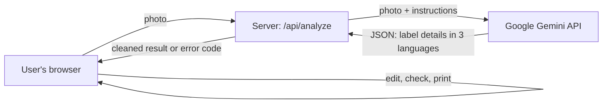

# Technical overview (step A8)

## Platform

Tańba AI is a web application. It runs in any modern browser on a computer or phone;
nothing is installed. One codebase serves both the pages and the server logic.

| Layer | Technology | Why |
| --- | --- | --- |
| Framework | Next.js 16 (React 19, TypeScript) | Pages and server code in one project; free hosting options |
| Interface | React components, plain CSS | Small and easy to explain; no UI library |
| Server | One Next.js route handler: `POST /api/analyze` | Keeps the AI key off the browser |
| AI | Google Gemini API through the official `@google/genai` SDK | Reads text in a photo and translates in one request |
| Fonts | Onest and Unbounded, bundled with the app | Cover Kazakh letters; no outside font requests |
| Tests | Vitest (rules), Playwright (browser journey) | Evidence that the journey and the error cases work |

## Architecture

1. **Browser.** Checks the file type and size, shows the photo, sends it to the server.
2. **Server (`app/api/analyze/route.ts`).** Applies the request limit, checks the file again
   (including its first bytes), and calls the AI. It holds the secret key.
3. **AI (`lib/gemini.ts`).** One request with the photo, fixed instructions and a JSON Schema,
   so the answer always has the same structure: eleven label details, each with the original
   text, a Kazakh and a Russian translation.
4. **Cleaning (`lib/normalize.ts`).** The answer is validated: unknown details are dropped,
   wrong types become empty text, long text is cut. If no text was found, the photo is treated
   as "not a label".
5. **Browser again.** The required-details check (`lib/compliance.ts`) runs in the browser after
   every edit, so the count updates at once and the AI is not called again.

The check follows TR CU 022/2011, article 4, part 4.1: product name, ingredients, quantity,
date of manufacture, shelf life, storage conditions, manufacturer, importer, nutrition facts
and the EAC mark are required (10 items); instructions for use and GMO information are
conditional. A detail counts as filled in only when both translations have text.

## Data storage

There is no database. The app stores nothing on the server: a photo lives in memory for one
request. The browser stores one value, the chosen interface language (`localStorage`).
The edited label exists only in the open page and disappears when it is closed.

## Integrations and dependencies

| Dependency | Role | If it fails |
| --- | --- | --- |
| Google Gemini API | Reading and translating | The user sees "The AI service did not respond"; nothing is lost |
| Hosting platform | Serves the app | The site is down; the backup recording is used |
| npm packages: `next`, `react`, `react-dom`, `@google/genai`, two font packages | Run time | Versions are pinned in `package-lock.json` |

Configuration is two environment variables: `GEMINI_API_KEY` and `GEMINI_MODEL`.
Without a key the app runs in demo mode with two built-in sample labels.

## Deployment

The app is built with `npm run build` and can be hosted on any platform that runs Next.js.
The repository is connected to the host, the two environment variables are set in the host's
settings, and each push to the main branch publishes a new version.

## Limitations

- **AI accuracy.** Translations and extracted values can be wrong, especially on blurry,
  curved or very dense labels. The app requires human review and says so.
- **Scope of the check.** Only the presence of the general required details is checked. Font
  size, product-specific regulations, allergen formatting and the truth of the content are not.
- **One photo per label.** Labels split across several sides are not combined.
- **No saved work.** Closing the page loses the edits.
- **Vendor dependency.** One AI provider. `lib/gemini.ts` is the only file to change to switch.
- **Cost and quota.** Each photo is one AI request. The request limit is in memory only.
- **Languages.** Interface: English and Kazakh. Output: Kazakh and Russian. The Kazakh text was
  drafted with AI and must be reviewed by a fluent speaker.
- **Not yet verified.** As of 18 Nov 2026 the AI path has been tested against a local stand-in
  for the Gemini service, not against the real service. See `docs/testing.md`.
